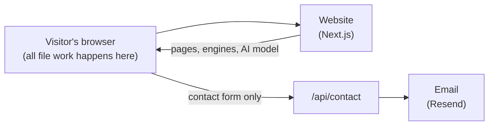

# Swift Converter Hub: System Overview

A plain-words tour of the whole project: what it is, who uses it, and how a file goes from a drop to a download without ever leaving the visitor's device.

---

## What it is

**Swift Converter Hub** (swiftconverterhub.com) is a free website full of everyday file tools: convert a photo, shrink a PDF, trim a video, format some JSON, count words.

Most converter sites upload your file to their server. This one doesn't. **Every tool runs inside the browser tab**, so photos, contracts and videos stay on the visitor's own device.

- 🧰 **46 tools in 6 studios**: Image, Audio, Video, Documents, Data and Text.
- 🔒 **No uploads, no sign-up, no file-size caps.**
- ⚡ **Fast**: video uses the device's graphics chip, and the AI background remover runs in about a second on most computers.
- 🔎 **Easy to find things**: search every tool with Ctrl/⌘ K, or drop any file on the home page and get the tools that can open it.
- 🌗 **Light and dark mode**, and it works on phones.

## Who uses it

| Who | What they do |
|---|---|
| **Visitors** | Convert, compress, edit and check files for free |
| **Developers** | Format JSON, test regex, compare text, make hashes and passwords |
| **The site owner** | Earns from ads, reads the contact form messages and adds new tools |

---

## The six studios

Each studio has its own colour, used everywhere it appears, so people learn "green = audio" without reading.

| Studio | Colour | Tools | What does the work |
|---|---|---|---|
| **Image** | Blue | Convert (150+ formats), Image ↔ Base64, Image to text (OCR), Crop & resize, Adjust & filter, Remove background, Compress, EXIF viewer | ImageMagick, on-device AI, Tesseract |
| **Audio** | Green | Convert, Trim, Merge, Adjust volume, Compress | FFmpeg |
| **Video** | Pink | Convert, Trim, Video to GIF, Extract audio, Compress | Graphics chip (WebCodecs), FFmpeg |
| **Documents** | Rose | Merge, Split, Compress, Rotate and Watermark PDF, Image to PDF, Word/Excel to PDF, PDF to Word | pdf-lib, PDF.js |
| **Data** | Amber | CSV, JSON, XML, YAML, TOML and Excel converters, JSON formatter, Base64 text | Small parsers |
| **Text** | Cyan | Word counter, Text diff, Sort lines, Case converter, Find & replace, Markdown preview, Lorem ipsum, Regex tester, URL encoder, Hash and Password generators, Unicode inspector, Number bases | Plain TypeScript |

There are also landing pages for popular pairs such as **HEIC to JPG** and **MOV to MP4**, so people searching for exactly that land on the right tool.

---

## A visitor's story

1. **Arrive.** The home page says it plainly: *"Convert files without uploading them."* Beside it is one big drop zone.
2. **Drop a file.** They drop a phone photo. The site lists every tool that can open it: convert, compress, crop, remove background, make a PDF.
3. **Pick a tool.** The tool opens **with the photo already loaded**, so they don't choose it twice. The file is passed along in memory, never saved anywhere.
4. **Adjust.** They pick a format or quality and see a preview. Tabs along the top let them jump to a sibling tool (Compress → Crop) without going back.
5. **Download.** The result is made in the tab and saved to their device. A batch of files comes as one ZIP.
6. **Come back.** Search remembers recently used tools. Once a tool has loaded, it keeps working even if the connection drops.

## How a file is processed

```
Drop file → load the engine (first time only, then cached) → process inside the tab → download
                          ↑
                 nothing is sent to any server
```

- **The engines are real programs** (ImageMagick, FFmpeg, Tesseract, an AI model) compiled to run inside the browser. The site downloads one the first time a tool needs it, then keeps it cached.
- **Heavy work runs in the background** (Web Workers), so the page never freezes.
- **The fastest route is tried first.** For video: a lossless copy if the format already fits, then the graphics chip, then FFmpeg. For the AI: the graphics chip (WebGPU), then the processor.

---

## How it fits together



- **Website (Next.js):** the pages, the 1200×630 share images for every page, the sitemap, and one small endpoint for the contact form.
- **The visitor's browser:** does all the converting, using engines the website serves itself (no outside CDNs).
- **Email (Resend):** delivers contact form messages to the team.

There is **no database and no file storage**, because no files ever arrive.

### Why visitors can trust it

- **Files never leave the device.** There is simply no code path that uploads them.
- **No outside servers see a request for the engines.** ImageMagick, FFmpeg, the AI model and the OCR data are all served from the site itself. Fonts are too.
- **Analytics are optional.** A consent banner asks first. Tools work the same either way.
- **Safe headers.** The site blocks being framed by other sites, file-type guessing, and access to camera, microphone and location.
- **The contact form is protected** with checks on every field, length limits and a limit of 5 messages per 10 minutes.

### Why the numbers hold up

- **Tested with real files.** Every tool was run end to end with real photos, recordings, videos, PDFs and spreadsheets, and the outputs were checked with professional tools.
- **About 30 unit test files** cover the tricky parts: PDF layout, watermark rotation, password randomness, format tables, ZIP file names.
- **Every change is checked automatically** before it reaches `main`: lint, type-check, tests and a full build.

---

## Flagship features

**AI background remover.** Cuts out people, pets and products on the visitor's device. We shrank the AI model from 178 MB to **47 MB** while keeping its cut-outs 99.8% identical. It takes about **1 second** on the graphics chip and about 15 seconds on the processor. Keep the image transparent, or use a colour, a blur or another photo as the background.

**Faster video.** Using the device's own video hardware made common jobs dramatically faster. Measured on a 20-second 720p clip:

| Task | Before | Now |
|---|---|---|
| MP4 → MOV | 32.4 s | **0.4 s** |
| MP4 → WebM | 93.6 s | **8.6 s** |
| Compress | 30.8 s | **5.1 s** |
| Trim | 13.1 s | **4.2 s** |

**Image to text (OCR).** Reads text from photos and scans in **15 languages**, including Sinhala, Tamil, Hindi, Arabic, Chinese and Japanese.

**Image to PDF.** Up to 50 images, live page previews, drag to reorder, rotate pages, and phone photos come out the right way up.

**Password generator.** Passwords, passphrases and PINs that avoid easy guesses, with a strength meter and time-to-crack. It uses the browser's secure random number source.

---

## Look and feel

The design follows one idea: **many tools, one calm place.** Each tool page has the same layout, so once you've used one, you know them all.

| Colour | Used for |
|---|---|
| Graphite white `slate-50` | Page background |
| Graphite `slate-900` | Text and headings |
| Cobalt blue `blue-600` | Brand colour, main buttons, links |
| Blue · Green · Pink · Rose · Amber · Cyan | One per studio: icons, tabs, highlights |
| Privacy green | The "Runs on your device – nothing is uploaded" badge on every tool |

**Fonts:** Bricolage Grotesque (headings), Geist Sans (text), Geist Mono (code and data). All are self-hosted, so the site doesn't contact Google for type.

**Every tool page has the same layout:** breadcrumb → icon, title and a one-line promise → feature badges → the tool → "How it works" in three steps → helpful notes → FAQ → more tools in this studio.

**The logo, "Studio Turbine":** six curved blades, one in each studio colour, turning around one hub. *Many converters, one place, in motion.* Each studio's share image lights up its own blade.

The layout fits the space each tool actually has, so ad columns never squeeze a tool. Ads use standard sizes, reserve their space before loading so the page doesn't jump, and disappear when there's nothing to show.

---

## Built with

Next.js 16 · React 19 · TypeScript · Tailwind CSS v4 · shadcn/ui · Radix · ImageMagick (WebAssembly) · FFmpeg (WebAssembly) · WebCodecs (mediabunny) · ONNX Runtime Web · Tesseract.js · pdf-lib · PDF.js · Resend · Vitest · GitHub Actions

## Where to find things

| Part | Folder |
|---|---|
| The list of every studio and tool | `config/tools.ts` |
| Pages (one folder per studio and tool) | `app/` |
| How each tool works | `features/<studio>/<tool>/` |
| Parts every tool shares | `features/shared/` |
| Header, footer, search, ads, consent | `components/` |
| Colours, fonts and design tokens | `app/globals.css`, `config/studio-theme.ts` |
| SEO and share images | `lib/seo.ts`, `app/og/route.tsx` |
| AI model and its worker | `public/models/`, `public/workers/` |
| Contact form email | `app/api/contact/`, `features/contact/` |

Setup, settings and deploying are in the **[README](README.md)**. Detailed release notes are in **[UI-UX-CHANGES.md](UI-UX-CHANGES.md)**.

---

## Good to know

- **The promise is the product.** Any new tool must work fully in the browser. If something can't be done without a server, it doesn't belong here.
- **First use of a big tool takes a moment** while its engine downloads (the AI model is 47 MB). After that it's instant.
- **Old browsers still work.** Without WebGPU or WebCodecs, tools quietly fall back to the slower WebAssembly engines.
- **Built by Softro Code Labs**, June to November 2026.
